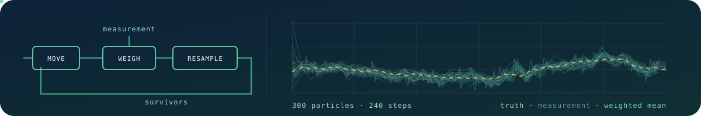

<p align="center">
  
</p>

# Portable Scalar Kalman Filter

<p align="center">
  
  
  
</p>

Smooths one stream of noisy numbers while still following real change. A
one-dimensional random-walk Kalman filter in portable C99 — no heap, no globals,
all state in an object you own.

One instance per independent scalar: temperature, distance, pressure, an ADC
reading, one sensor axis. **Not** a matrix filter; it does not fuse axes.

## Use

```c
#include "kalman_filter.h"

struct kalman_filter filter;
float filtered;

if (kalman_filter_init(&filter) != KALMAN_FILTER_OK)
	return 1;

if (kalman_filter_update(&filter, 10.0f, &filtered) != KALMAN_FILTER_OK)
	return 1;

printf("%.2f\n", filtered);
```

The first update seeds the estimate with the measurement; later ones smooth.
With default tuning, the first rows of `examples/basic.c`:

| Raw | Filtered |
|---:|---:|
| 10.00 | 10.00 |
| 11.20 | 10.60 |
| 9.40 | 10.20 |
| 10.80 | 10.35 |

### API

```c
enum kalman_filter_status
kalman_filter_init(struct kalman_filter *filter);

enum kalman_filter_status
kalman_filter_init_with_noise(struct kalman_filter *filter,
                              float process_noise,
                              float measurement_noise);

enum kalman_filter_status
kalman_filter_reset(struct kalman_filter *filter);

enum kalman_filter_status
kalman_filter_update(struct kalman_filter *filter,
                     float measurement,
                     float *result);
```

`reset()` discards the estimate so the next update reseeds, keeping the tuning.

### Tuning

Defaults are process noise `0.01f`, measurement noise `1.0f`.

- **Process noise** — finite, `>= 0`. Higher follows real change faster.
- **Measurement noise** — finite, `> 0`. Higher smooths more.

Set both with `kalman_filter_init_with_noise()`.

### Status codes

| Status | Meaning |
|---|---|
| `KALMAN_FILTER_OK` | Succeeded |
| `KALMAN_FILTER_ERR_NULL` | A required pointer was null |
| `KALMAN_FILTER_ERR_NOT_FINITE` | A supplied value was not finite |
| `KALMAN_FILTER_ERR_INVALID_VALUE` | Out of range — bad tuning, or an output pointer into the filter object |
| `KALMAN_FILTER_ERR_NOT_INITIALIZED` | Not initialised, or invalid state |
| `KALMAN_FILTER_ERR_NUMERIC` | Calculation produced no valid finite result |

Initialise before updating or resetting. A failed call leaves both the filter and
the output untouched. The output pointer must not point into the filter object.

## Build

```sh
make check    # run the tests
make run      # run examples/basic.c
```

Or drop `include/kalman_filter.h` and `src/kalman_filter.c` straight into your
own project — that is the whole install. Nothing here is tied to a platform:
C99, `libm` only, no heap, no globals, no I/O.

```sh
cc -std=c99 -Wall -Wextra -Werror -pedantic -Iinclude \
  examples/basic.c src/kalman_filter.c -lm -o basic
```

C++ can use it through the header's `extern "C"`, which `make check` verifies.
Separate instances are independent; synchronise a shared one yourself.

## Algorithm

```text
predicted covariance = covariance + process noise
gain = predicted covariance / (predicted covariance + measurement noise)
estimate = previous estimate + gain * (measurement - previous estimate)
covariance = (1 - gain) * (1 - gain) * predicted covariance
             + gain * gain * measurement noise
```

The covariance line is the Joseph form.
