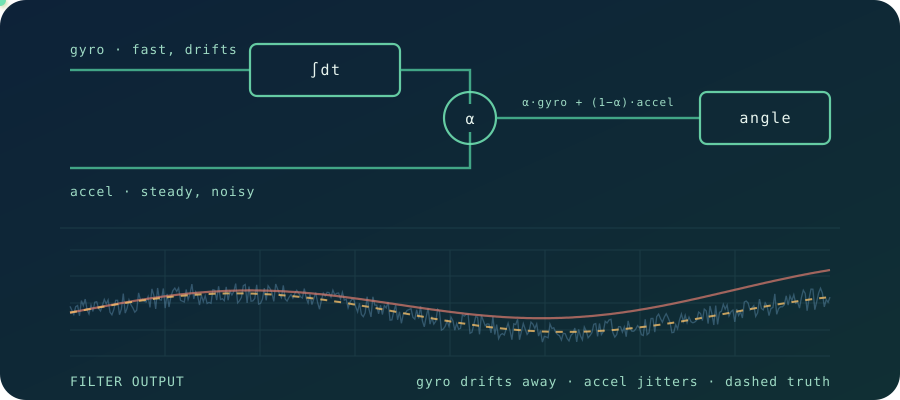

<p align="center">
  
</p>

# Complementary Filter

<p align="center">
  
  
  
</p>

Estimates a tilt angle from a gyroscope and an accelerometer.

Neither sensor can do it alone. A gyroscope is smooth and fast but **drifts** —
integrate its small bias and your angle wanders away for good. An accelerometer
always knows which way is down so it never drifts, but it is **noisy** and every
bump shakes it. A complementary filter takes the steady part of one and the
quiet part of the other: trust the gyroscope moment to moment, and lean on the
accelerometer slowly to cancel the drift. One line of arithmetic, and the pair
beats either sensor alone.

`make run` shows it: after 5 seconds of a 2 deg/s gyro bias, the gyroscope alone
is 10 degrees wrong and the filter is 1 degree off.

- One header, one source file. Drop them into any C project.
- C99 with `libm` and nothing else. No allocation, no globals, no I/O.
- Nothing platform-specific — microcontroller, Linux, anywhere.

## Install

Copy `include/complementary_filter.h` and `src/complementary_filter.c` into your
project and build them with your own sources. That is the whole install.

With CMake, link the target `algo::complementary` instead; for ESP-IDF, use
this folder as a component. See [Use one library](../README.md#use-one-library).

## Use

```c
#include "complementary_filter.h"

struct complementary_filter filter;

complementary_filter_init(&filter, 0.0f, 0.98f);

float angle = complementary_filter_update(&filter, gyro_rate_dps,
                                          accel_angle_deg, dt_s);
```

| Argument | Meaning |
|---|---|
| `initial_angle_deg` | Starting angle. The first accelerometer angle is a good value |
| `alpha` | Gyroscope weight, clamped to `[0, 1]`. `0.98` is a starting point — tune for your noise and sample rate |
| `gyro_rate_dps` | Angular velocity, degrees per second |
| `accel_angle_deg` | Angle from the accelerometer, degrees |
| `dt_s` | Elapsed time, seconds |

`complementary_filter_reset()` sets a new angle without touching `alpha`.

Gyro and accelerometer values must describe the **same axis with the same
positive direction**.

### Invalid input

All inputs must be finite; the filter degrades rather than faults.

- `dt_s <= 0` — ignored, returns the current angle
- Invalid update input — last finite angle kept
- Non-finite initial angle — becomes `0`
- Non-finite reset angle — ignored
- Non-finite `alpha` — falls back to `0.98`
- Null filter pointer — safe, update returns `0.0f`

The fields are public, so each update also repairs a non-finite stored angle to
`0` and revalidates `alpha`.

Accelerometer correction takes the shortest path across the `-180`/`180`
boundary. Gyroscope integration is **not** wrapped, so continuous motion stays
intuitive and the angle is not confined to one revolution.

### Choosing alpha

`alpha` is how long you trust the gyroscope. Higher is smoother but lets more
gyro bias through; lower corrects harder toward the accelerometer and lets more
of its noise through. A constant gyro bias leaves a small steady error, on the
order of `bias * dt * alpha / (1 - alpha)` — the degree the example ends on.

See `examples/angle.c`, and `docs/algorithm.md` for how the filter works.

## Build

```sh
make check    # run the tests, including the C++ linkage smoke test
make run      # run examples/angle.c against simulated sensors
```

## License

© 2026 JonasAtelier, GPL-3.0-only
