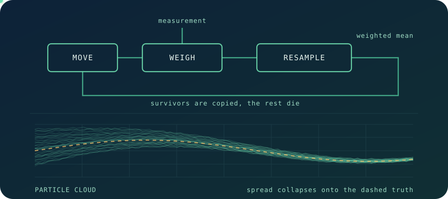

<p align="center">
  
</p>

# Particle Filter

<p align="center">
  
  
  
</p>

Estimates one changing value from measurements too noisy to use directly.

Instead of one guess, it keeps a **cloud of guesses** — the particles. Each
step, every particle moves the way you say the truth moved, then gets a score
for how well it agrees with the new measurement. Good guesses survive and get
copied, bad ones die off, and the weighted average of the survivors is your
estimate. It costs more than a Kalman filter, and buys you something Kalman
cannot do: it never assumes the noise is a neat bell curve.

`make run` shows it tracking a moving value through a sensor that is off by
1.04 on average, and coming out 0.15 off.

- One header, one source file. Drop them into any C project.
- C99 with `libm` and nothing else. No allocation — **you** own the arrays.
- Nothing platform-specific — microcontroller, Linux, anywhere.

## Install

Copy `include/particle_filter.h` and `src/particle_filter.c` into your project
and build them with your own sources. That is the whole install.

With CMake, link the target `algo::particle` instead; for ESP-IDF, use this
folder as a component. See [Use one library](../README.md#use-one-library).

## Use

```c
#include "particle_filter.h"

static struct particle_filter filter;
static float particles[100];      /* you own the storage, not the library */
static float weights[100];
static float scratch[100];

particle_filter_init(&filter, particles, weights, scratch, 100,
		     0.0f,     /* first guess                     */
		     5.0f,     /* how unsure you are of it        */
		     0.2f,     /* how unpredictably the truth moves */
		     1.0f,     /* how much the sensor lies        */
		     1234U);   /* seed                            */

/* then, every sample: */
particle_filter_predict(&filter, movement_since_last_call);
particle_filter_update(&filter, sensor_reading);

float estimate = particle_filter_get_estimate(&filter);
```

Call `predict` before `update` for each sample. Weights are normalised and the
filter resamples automatically when too few particles remain effective.

### `particle_filter_init()`

| Argument | Meaning |
|---|---|
| `particles`, `weights`, `scratch` | Caller-owned arrays |
| `particle_count` | Length of all three |
| `initial_value` | Starting estimate |
| `initial_spread` | Standard deviation of the starting cloud |
| `process_noise` | Standard deviation added per `predict` |
| `measurement_noise` | Standard deviation assumed of the sensor |
| `seed` | RNG seed |

The three arrays **must not overlap** and must stay valid for the filter's
lifetime. At 100 particles they cost about 1.2 KiB total.

Initial value, spread, movement, both noise figures and your sensor readings must
all use the **same unit**. Spreads and noise are standard deviations.

`init`, `reset`, `predict` and `update` return `0` on success, `-1` on invalid
input.

### How many particles?

More particles mean a better estimate and more work — cost is linear in the
count. A hundred is a reasonable start for a scalar; a thousand is generous.
Watch `particle_filter_get_effective_count()`: it says how many particles still
carry useful weight. If it collapses toward 1, your `measurement_noise` is
probably set far tighter than the sensor really is.

See [`examples/track.c`](examples/track.c) and the
[algorithm and tuning guide](docs/algorithm.md).

## Build

```sh
make check    # run the tests, including the C++ linkage smoke test
make run      # run examples/track.c against a simulated noisy sensor
```

## License

MIT
